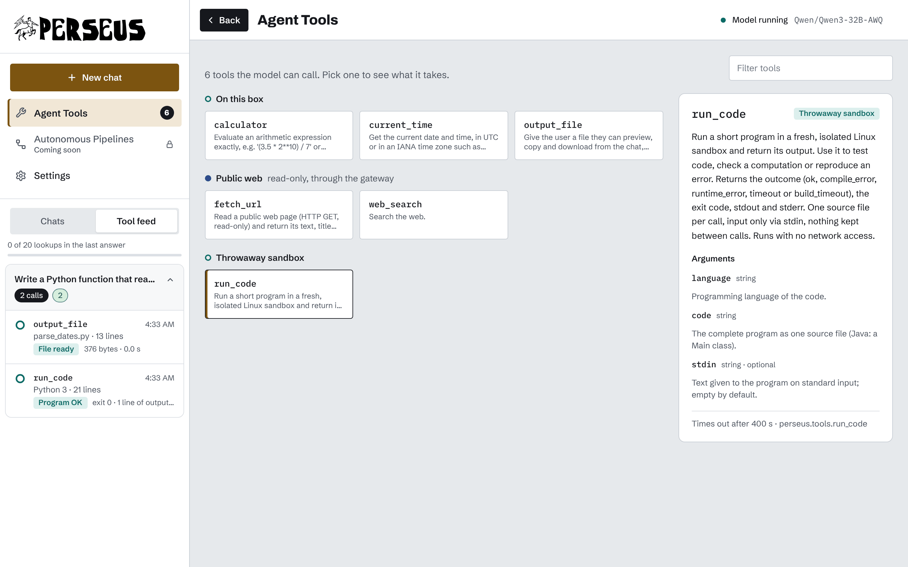

<div align="center">

<picture>
  <source media="(prefers-color-scheme: dark)" srcset="docs/logo-dark.svg">
  
</picture>

**Your own AI assistant, running on a GPU server you control.**<br>
Perseus turns a Linux GPU box and an open-weight model into a private assistant that can search the web, run code and hand you files.


[](LICENSE)

[Install](#installing-perseus) · [Update](#updating-perseus) · [Using it](#using-the-dashboard) · [Agent functions](#agent-functions) · [Code runner](#the-code-runner) · [Settings](#configuration) · [Safety](#how-perseus-keeps-you-safe) · [License](#license)

</div>

---

<p align="center">
  
</p>

## What is Perseus?

You bring a GPU server and pick a model from Hugging Face. Perseus does the rest: it works out how to fit the model on your hardware, downloads it, starts it, checks that it works, and gives you a dashboard in your browser to chat with it.

While it answers, the model can use a handful of agent functions: search the web, read pages, do exact maths, run code in a throwaway sandbox, and give you files to download. Every call shows up in a live feed, so you can see exactly what it did and why something was blocked.

Nothing leaves your box unless Perseus has checked it first. The model never touches the network directly, the dashboard only listens on the box itself, and you reach it through an SSH tunnel.

## What you need

| | |
| --- | --- |
| A GPU server | Linux (Ubuntu or Debian are tested) with at least one NVIDIA GPU. 24 GB of GPU memory or more is a good start. Rented cloud boxes work well. |
| NVIDIA driver 580 or newer | Most GPU images ship one. On a plain VM, Perseus can install it for you. |
| Disk space | Enough for the model's weights (the check tells you how much), plus about 10 GB for Perseus's Python environment. |
| A Hugging Face account | Only if your model is gated (for example Llama). Make an [access token](https://huggingface.co/settings/tokens). |
| On the box | `bash`, `git` and `python3`. Everything else (uv, Python 3.12, vLLM, the search engine) is installed for you. |
| Optional: an E2B account | Only for the code runner. The free plan is enough for one person. |

## Installing Perseus

Do steps 1 to 7 on the GPU server, over SSH. Step 8 happens on your own computer.

### 1. Get the code

```bash
git clone https://github.com/IMONSP33D/Perseus.git perseus
cd perseus
```

Run every later command from inside this `perseus` folder.

### 2. Create your config files

```bash
bash Config/configuration.sh
```

This makes three files in `Config/`, copied from the commented templates in `Config/templates/`. They are only readable by you, and git ignores them, so your keys never get committed.

| File | What goes in it |
| --- | --- |
| `Config/provider.toml` | Which model to run, and your Hugging Face token |
| `Config/settings.toml` | How it runs: ports, search engines, limits. The defaults are fine to start |
| `Config/tooling.toml` | Settings for the agent functions, including the code runner's key |

It finishes by listing what you still need to fill in.

### 3. Choose your model

Open `Config/provider.toml`:

```bash
nano Config/provider.toml
```

```toml
[model]
id = "Qwen/Qwen3-32B-AWQ"     # any Hugging Face repo with safetensors weights

[secrets]
hf_token = "hf_..."           # only needed for gated or private models
```

A few tips on picking a model:

- Match it to your GPU memory. An already-quantized repo (names ending in `-AWQ`, `-GPTQ` or `-FP8`) fits far more model into less memory. As a guide, a 32B AWQ model on one 24 GB card runs with about 13K tokens of context. Step 5 tells you exactly what you'll get before anything is downloaded.
- Gated models need you to accept the licence on the model's Hugging Face page, with the same account as your token.
- Pick a model that can call tools, because the agent functions depend on it. Perseus picks the right tool-call format for the model and tests it on first boot.

### 4. (Optional) Turn on the code runner

Skip this for now if you like; you can add it any time. See [The code runner](#the-code-runner) for the full steps. In short, put your E2B key in `Config/tooling.toml`:

```toml
[code_runner]
api_key = "e2b_..."
```

### 5. Check everything before downloading

```bash
bash preflight.sh --check
```

This takes seconds and installs nothing heavy. It checks your config, the driver and GPUs, that your token can see the model, and how the model will fit. You'll see a summary like this:

```
Sizing
  ✓ TP=1, weights repo:awq (18.4 GiB/GPU), KV cache 1.7 GiB fp8, context 13,312 tokens
  ✓ tool results capped at 800 tokens; research depth on this GPU: Quick 2, Standard 8, Deep 20 lookups

Data directory
  ✓ data directory: /workspace/perseus (weights in weights/Qwen/…)
```

If the model doesn't fit, it says so and suggests what would. Fix the config and run it again; finding out here costs seconds instead of a long download.

### 6. Prepare the box

```bash
bash preflight.sh
```

This does the real work, in six steps. Each one prints a ✓ when it's done:

1. NVIDIA driver: checks it's new enough.
2. Python environment: installs `git` and `curl` if they're missing, then uv and Python 3.12.
3. Checks: everything from step 5, again.
4. vLLM, the model server, plus a quick test that it can use your GPU. This takes a few minutes.
5. SearXNG, a private search engine that runs on the box.
6. The model download, with a live progress panel. Afterwards your Hugging Face token is wiped from the box's caches.

You can stop it and run it again at any time. Finished steps are skipped, and an interrupted download picks up where it left off.

The big files (weights, logs, the search engine) go into a data directory on the fastest disk with enough room, not into your checkout. Preflight tells you where it put it.

### 7. Start Perseus

```bash
python3 perseus.py
```

Perseus runs a set of safety checks, starts the search engine and the model, times the first reply and makes a test tool call. When it's ready, it prints a sign-in link and the exact SSH command to use, ready to copy.

The first start takes longest, while the model loads onto the GPU.

### 8. Open the dashboard (on your own computer)

The dashboard only listens on the server itself, so you reach it through an SSH tunnel. In a terminal on your own computer, run the command Perseus printed. It looks like this:

```bash
ssh -N -o ExitOnForwardFailure=yes -L 8080:127.0.0.1:8080 you@your-gpu-box
```

Leave that running. Then open the link Perseus printed (`http://127.0.0.1:8080/?token=…`) in your browser. After the first visit you're signed in, and plain `http://127.0.0.1:8080/` works.

Perseus's terminal says `✓ a browser signed in` when you arrive. If you lose the link, it's saved in `run/dashboard.url` inside the data directory.

To stop Perseus, press Ctrl-C in its terminal. That also stops the model and the search engine.

### If something goes wrong

| What you see | What to do |
| --- | --- |
| `no working NVIDIA driver` | On a VM: `bash preflight.sh --install-driver`, reboot, then run preflight again. On a container host: choose a GPU image that includes the driver. |
| `NVIDIA driver … is older than 580` | Pick an image with a newer driver. Perseus doesn't upgrade drivers itself. |
| `… is gated and this token hasn't been granted access` | Accept the model's licence on Hugging Face with the account that owns your token. |
| `… doesn't fit on …` | Choose a smaller or quantized model, or follow the suggestions it prints. |
| `AllowTcpForwarding no, so an SSH tunnel will be refused` | On the server, set `AllowTcpForwarding yes` in `/etc/ssh/sshd_config`, then `sudo systemctl reload ssh`. |
| The tunnel says `administratively prohibited` | Same as above: SSH forwarding is switched off on the server. |
| The tunnel says `Connection refused` | Perseus isn't running. Start it with `python3 perseus.py`. |
| Port 8080 is busy on your computer | Use `-L 9000:127.0.0.1:8080` and open `http://127.0.0.1:9000/?token=…` instead. |

Each run of preflight is logged in `logs/preflight.log` in the data directory. If it fails before that exists, it prints where the log went.

## Updating Perseus

Your settings, keys and downloaded model are kept when you update.

### The usual update

```bash
# 1. stop Perseus (Ctrl-C in its terminal)

# 2. get the new version
cd perseus
git pull

# 3. (optional) see what will change in your config, without changing anything
bash Config/configuration.sh --check

# 4. update everything
bash preflight.sh

# 5. start it again
python3 perseus.py
```

What step 4 does:

- Updates your config. New settings arrive with their defaults, and defaults you never changed follow the new version. Anything you set yourself (model, keys, ports) is left alone. If a setting was removed, it's listed on screen. Your old files are copied to `Config/.backup/<time>/` first.
- Moves Python packages and vLLM to the exact versions the new release pins.
- Moves the search engine to its new pinned version, if that changed.
- Skips the model download, since it's already there and verified.

### Changing to a different model

1. Stop Perseus.
2. Put the new model's `id` in `Config/provider.toml`.
3. Run `bash preflight.sh --check` to see how it fits, then `bash preflight.sh` to download it.
4. Start Perseus.

The old model's weights stay in `weights/` in the data directory. Delete that folder yourself if you want the space back.

### Going back to an earlier version

```bash
git log --oneline              # find the version you want
git checkout <commit>
bash preflight.sh              # puts packages back to that version's pins
```

If you want your config exactly as it was too, copy the files back from the matching `Config/.backup/<time>/` folder. Run `git checkout main` to return to the latest version.

## Using the dashboard

The left sidebar has New chat, Agent Tools, Settings and two tabs: your chats and the Tool feed. Click the logo to jump to the top of the chat. Back, at the top left, returns to the page you came from.

| Control | What it does |
| --- | --- |
| Context pill | Next to the chat title: how much of the model's context window the chat has used. Its bar runs green to red as it fills. |
| Web on / Web off | Under the message box. Off: the model can't search or read web pages. The code runner isn't affected. |
| System prompt switch | Under the message box: Researcher, Engineer, Planner or Custom. |
| Low … Max thinking | Under the message box: how long the model may think before answering (Low 4K, Medium 16K, High 32K tokens, or Max). When it runs out, Perseus wraps up and says so. |
| Gear | Under the message box: Chat settings, the per-question settings in one place. |
| Thinking | Shown above each answer. Shrink folds it to one line; Expand opens it again. |
| Close out | While it's working: stop thinking and researching, and write the answer now. |
| Stop | The send button turns into Stop while an answer runs. You keep what it wrote so far. |
| Attach | The button left of the message box. Add up to five text files, 60 MB in total, to a message. Each shows its size. A file bigger than the model's memory can't be read in full. |
| Tool feed | A sidebar tab: every tool call, grouped by question, with its arguments, its result, and why it was blocked if it was. "N tool calls" under an answer opens it at that question. |
| View raw | Under each answer: exactly what was sent to the model and what it sent back. |

Settings has one box per setting: light or dark theme, context window (8K, 32K, 128K or Max; options that don't fit your GPU are greyed out), answer length, thinking, creativity, web access, research depth, search engines, the system prompt (or your own, up to 8,000 characters) and chat history. A new context window takes effect after Restart model, at the bottom of the page; everything else applies right away.

Chats are kept in memory on the server and disappear when Perseus stops. Export, under Chat History in Settings, saves them as a JSON file.

Autonomous Pipelines is greyed out for now. It's a multi-step workflow feature that isn't finished yet.

## Agent functions

<p align="center">
  
</p>

These are what the model can do while it answers. Open Agent Tools in the sidebar and pick one to see what it does and the arguments it takes. They're grouped by where a call goes: on this box, the public web, or the throwaway sandbox.

| Function | What it does |
| --- | --- |
| `web_search` | Searches the web through the private search engine on your box |
| `fetch_url` | Reads a web page, through Perseus's read-only web gateway |
| `calculator` | Exact arithmetic, so the model doesn't have to guess |
| `current_time` | The current date and time |
| `output_file` | Gives you a file (Markdown, code, CSV, …) to preview, copy or download, instead of pasting it into the answer. It can give several files in one answer. |
| `run_code` | Runs a program in a fresh cloud sandbox. Only shown once the [code runner](#the-code-runner) is set up. |

### Writing your own

Each function is one Python file in `perseus/tools/`. Copy [`_example.py`](perseus/tools/_example.py), give it a new name and edit it. Perseus picks up new and changed files before the next answer, with no restart needed.

```python
from typing import Annotated
from perseus.tools import tool

@tool
def word_count(text: Annotated[str, "The text to count."]) -> dict:
    """Count the words in a piece of text."""
    return {"words": len(text.split()), "characters": len(text)}
```

The docstring is what the model reads, and the type hints become the argument schema (`str`, `int`, `float`, `bool`, `list[...]`, `Literal[...]` for a fixed set of choices, and `X | None` for optional values). For limits such as `maxLength` or `pattern`, pass a JSON Schema as `parameters=` instead.

The rules:

- Return a dict, list or string. Raise `ToolFailure("…")` to give the model a clear error message. Any other exception reaches the model only as its type name.
- Don't import network or process libraries (`socket`, `requests`, `subprocess` and so on). Perseus refuses to load a file that does.
- Take `ctx` as the first argument when you need it. To read the web, use `ctx.gateway.fetch(url)`. To search, use `ctx.search`. To run code, use `ctx.sandbox`.
- Set `lookup=True` on anything that reads the web, for example `@tool(lookup=True)`. It then counts towards the research limit, and its results are marked as untrusted.
- Every tool needs a unique name. A file that reuses another file's tool name is refused, and the reason appears on the Agent Tools page.

## The code runner

`run_code` lets the model test its code before giving it to you. Each run happens in a brand-new virtual machine on [E2B](https://e2b.dev), which is deleted straight afterwards. Nothing runs on your GPU server.

To set it up:

1. Create an API key at [e2b.dev](https://e2b.dev) and add it to `Config/tooling.toml`:
   ```toml
   [code_runner]
   api_key = "e2b_..."
   ```
2. Build the sandbox image with all the compilers. You only do this once, it builds on E2B's side, and it needs no Docker. (Preflight installs uv in `~/.local/bin` without adding it to your PATH, hence the full path.)
   ```bash
   ~/.local/bin/uv run python -m setup.sandbox.build_template
   ```
3. Tell Perseus to use that image, in the same section of `Config/tooling.toml`:
   ```toml
   e2b_template = "perseus-code"
   ```
4. Run `bash preflight.sh`, then `python3 perseus.py`. On startup you'll see `✓ code runner: e2b · python, javascript, …`, or a line saying why it's off.

If you skip step 2, you get E2B's standard image, which has Python, JavaScript and Bash only. With the full image you also get C, C++, Rust, Go and Java. Perseus checks which languages are really there and only offers those.

What programs can reach is set by `network` in `[code_runner]`:

| `network` | Programs can reach |
| --- | --- |
| `"none"` | Nothing at all |
| `"packages"` (default) | Package registries only (pip, npm, cargo, Go and Maven), so installs work |
| `"full"` | The whole internet |

Perseus tests the network from inside a real sandbox at startup. If programs can reach more than the setting allows, it turns the code runner off.

To check where your code actually runs, run `~/.local/bin/uv run python -m perseus.sandbox.doctor`. It creates one sandbox with your key, shows its E2B id and what it reports about itself, then deletes it. Every run is also logged in `logs/sandbox.log`, without the code or its output.

## Configuration

Your settings are in the three files in `Config/` (see [step 2](#2-create-your-config-files)). Each file is commented, so the quickest way to learn them is to read it.

- Settings marked `"auto"` are worked out from your hardware and model. Anything you type instead wins.
- What was decided is saved in `perseus.resolved.toml` in the data directory.
- After changing the model or sizing settings, run `bash preflight.sh` again before starting Perseus.
- To change one setting for a single run: `bash preflight.sh --model.id Qwen/Qwen3-32B-AWQ`.

These are the settings you're most likely to change:

| Setting | File | What it does |
| --- | --- | --- |
| `[model] id` | provider | The Hugging Face model to run |
| `[secrets] hf_token` | provider | Your Hugging Face token (only preflight reads it) |
| `[model] revision` | settings | `"main"`, or a commit hash for an exact, repeatable version |
| `[model] quantization` | settings | `auto`, `fp8`, `bf16`, `awq` or `gptq` |
| `[model] max_context` | settings | `auto`, or how many tokens the model can hold in mind at once |
| `[model] tensor_parallel` | settings | `auto`, or how many GPUs to split the model across (1, 2, 4 or 8) |
| `[storage] data_dir` | settings | `auto` (fastest disk with room), or a folder of your choice |
| `[server] port` | settings | The dashboard's port (8080) |
| `[server] public` | settings | `true` opens the dashboard to your network instead of only the box. Anyone with the link can then use your model. |
| `[search] engines` | settings | Which search engines to ask |
| `[limits] research_depth` | settings | `quick` (5), `standard` (20) or `deep` (50) web lookups per answer. Lower on small GPUs. |
| `[code_runner] api_key` | tooling | Your E2B key; turns the code runner on |

<details>
<summary><b>All the other settings</b></summary>

| Setting | Default | Notes |
| --- | --- | --- |
| `[model] tool_parser`, `reasoning_parser` | `auto` | Override if auto picks wrong; `reasoning_parser = "none"` turns it off |
| `[model] trust_remote_code` | `false` | `true` needs `revision` set to a commit hash |
| `[model] cpu_offload_gb` | `0` | Single GPU only: keep this many GB of weights in RAM (slower) |
| `[model] small_gpu` | `auto` | The small-GPU profile: smaller tool results and research depth |
| `[server] bind` | `127.0.0.1` | |
| `[search] port` | `8888` | Local only; the model can never reach it with `fetch_url` |
| `[backend] max_restarts` | `3` | How often a crashed process is restarted |
| `[backend] fast_start` | `false` | Load faster but generate slower |
| `[limits] fetch_timeout_s` | `15` | Seconds per web page |
| `[limits] max_response_kb` | `2048` | Largest web page Perseus will read |
| `[limits] warn_download_minutes` | `20` | Warn when the download will take longer |
| `[code_runner] enabled` | `true` | Does nothing until `api_key` is set |
| `[code_runner] e2b_template` | `""` | The sandbox image; `""` is E2B's standard one |
| `[code_runner] network` | `packages` | `none`, `packages` or `full` |
| `[code_runner] languages` | `[]` | Empty means every installed language, or a list like `["python", "rust"]` |
| `[code_runner] build_timeout_s` | `120` | 5–180 |
| `[code_runner] run_timeout_s` | `30` | 1–120 |
| `[code_runner] max_output_kb` | `64` | Output kept per run |

To keep your config somewhere else, pass `--config DIR` to both `preflight.sh` and `perseus.py`.

</details>

## How Perseus keeps you safe

Perseus assumes the model might be tricked (for example by a web page telling it to do something), so it checks everything the model asks for before anything happens.

- Every function call is checked. Malformed or unexpected arguments are refused without running, and one answer can only do so much web research.
- Web access is read-only: the gateway downloads pages but can't post forms or log in. It refuses private and internal addresses, URLs carrying secrets, and disguised IP addresses, and it rechecks every redirect.
- Pages and program output reach the model marked as untrusted data, and text that looks like instructions is flagged in the feed.
- Perseus refuses any other outgoing connection.
- Programs only run in remote, throwaway sandboxes, and the sandbox key never reaches the model's process.
- The model server runs offline, on the box only, with a fresh key each boot and no Hugging Face token.
- The dashboard needs a sign-in and accepts changes only from its own page. Model and web text are shown as plain text, so they can't run as code in your browser.

Before Perseus starts, it runs 21 of these refusal checks and won't start if any of them fail.

<details>
<summary><b>More detail: the web gateway rules</b></summary>

| Rule | What it means |
| --- | --- |
| Method | GET and HEAD only. |
| Secrets | URLs can't carry anything that looks like a key or token (Hugging Face, OpenAI, Anthropic, GitHub, AWS, Slack, Google, JWTs, long random strings), or this boot's model-server key. |
| Shape | http and https on ports 80 and 443 only. No `user@host`, no disguised IPs (`2130706433`, `0x7f.1`, `127.1`), no internal names. At most 2,048 characters. |
| Address | The name is looked up once and refused if it points anywhere private, local or reserved. The connection goes to that exact address, while still checking the site's certificate. |
| Request | No body, cookies or login headers, and never through a proxy. |
| Limits | A timeout, a size cap (including compressed "zip bombs"), a per-site rate limit and an off switch. |
| Response | Web pages become plain text and links; scripts and styles are removed. Binary files are reported, never passed on. |

</details>

## Command-line options

<details>
<summary><b><code>preflight.sh</code></b></summary>

| Option | What it does |
| --- | --- |
| `--check` | Check config, hardware, model access and fit, without installing anything heavy |
| `--install-driver` | Ubuntu VM only: install the NVIDIA driver, then reboot and run again |
| `--skip-download` | Do everything except download the model |
| `--config DIR` | Use config files from another folder |
| `--section.key value` | Change one setting for this run only |

</details>

<details>
<summary><b><code>perseus.py</code></b></summary>

| Option | What it does |
| --- | --- |
| `--console` | Chat in the terminal instead of the dashboard |
| `--ask "question"` | Answer one question, show the function calls, then exit |
| `--selftest` | Run only the safety checks |
| `--replay FILE.json` | Replay a saved chat offline, with no GPU or network |
| `--config DIR`, `--data DIR` | Use another config folder or data directory |
| `--fast-start` | Load faster, generate slower |
| `--timings` | Show how long the last startup took |
| `--print-cmd` | Show the command used to start the model server |

In the terminal console: `/depth quick|standard|deep`, `/web off|on`, `/feed`, `/prompt`, `/export`, `/reset` and `/exit`.

</details>

<details>
<summary><b>The HTTP API</b></summary>

For scripts, send `Authorization: Bearer <token>`, using the token from the sign-in link. Anything that changes something also needs an `X-Perseus: 1` header.

| Method | Path | |
| --- | --- | --- |
| `GET` | `/api/state` | Model, settings, status and chats |
| `PATCH` | `/api/settings` | Change settings |
| `POST` | `/api/model/apply` | `{"context": N}`: restart the model with a new memory size |
| `GET` `POST` `DELETE` | `/api/chats` | List, create or delete all chats |
| `GET` `DELETE` | `/api/chats/<id>` | One chat |
| `POST` | `/api/chats/<id>/messages` | `{"text": …}`. Replies as a stream of `start`, `text`, `retract`, `phase`, `tool`, `file` and `done` events. |
| `POST` | `/api/chats/<id>/stop`, `/closeout` | Stop or close out the running answer |
| `GET` | `/api/chats/<id>/files/<file id>` | Download a file the model gave you |
| `GET` | `/api/chats/<id>/raw/<message id>` | The raw prompt and output |
| `GET` | `/api/tools`, `/api/pipelines` | Agent functions and pipeline definitions |
| `GET` | `/api/export` | All chats as JSON |
| `GET` | `/healthz` | Health check (no sign-in needed) |

</details>

## For contributors

<details>
<summary><b>Where things are</b></summary>

Perseus keeps two places separate: the checkout you cloned (code and config), and the data directory that preflight makes on your fastest disk (weights, logs, the search engine). Nothing big or secret goes in the checkout.

```
perseus/                     the checkout
├── Config/                  your config files, their templates, and the update merge
├── preflight.sh             prepares the box
├── perseus.py               starts Perseus
├── setup/                   what preflight runs: checks, sizing, download, installers
├── perseus/
│   ├── engine/              the loop that checks and runs function calls
│   ├── model/               starting vLLM and talking to it
│   ├── tools/               one file per agent function
│   ├── safety/              web gateway, network guard, self-test
│   ├── sandbox/             the code runner
│   ├── web/                 the dashboard (static/ is the page itself)
│   └── pipelines/           pipeline definitions (not running yet)
├── docs/                    images for this README
└── tests/                   332 tests; no GPU or network needed

<data directory>/perseus/    e.g. /workspace/perseus
├── weights/                 the downloaded model
├── perseus.resolved.toml    what preflight decided
├── logs/                    preflight, model server, search, sandbox, gateway
├── searxng/                 the search engine
└── run/                     per-boot keys and the dashboard link (cleared on shutdown)
```

The one large thing in the checkout is the Python environment, `.venv` (about 10 GB). Set `UV_PROJECT_ENVIRONMENT` before running both scripts to put it somewhere else.

</details>

The tests need no GPU, network or extra packages, and take under a minute:

```bash
python3 -m unittest discover -s tests -t .
```

To try the preflight checks without a GPU, run them against a recorded machine and model:

```bash
PERSEUS_FAKE_HW=tests/fixtures/hw_1x4090.json \
  python3 -m setup.check_config check --meta-file tests/fixtures/meta_qwen25_32b_awq.json
```

Before your first commit, install the hook that stops tokens and config files being committed:

```bash
~/.local/bin/uvx pre-commit install
```

If you change the config format, edit `Config/templates/` and `perseus/config.py` together. If you rename or move a setting, add a line to `MOVES` in [`Config/update.py`](Config/update.py) so people's existing configs follow it on their next update.

To test the code runner against E2B (this uses your key and costs a few cents):

```bash
PERSEUS_TEST_E2B=1 ~/.local/bin/uv run python -m unittest tests.test_sandbox_conformance
```

## License

Perseus is free software under the [GNU Affero General Public License v3.0](LICENSE). You can use, study, change and share it. If you share a changed version, or let other people use one over a network, you have to make its full source available to them under the same licence.

Copyright © 2026 IMONSP33D. As the copyright holder, the maintainer may also offer Perseus under other terms, including commercial licences, and may release future versions under a different licence. Versions already released under the AGPL stay available under it.

Contributions are accepted under a Contributor Licence Agreement that lets the maintainer relicense them, so the project can keep offering other terms. Please open an issue before sending a pull request.
